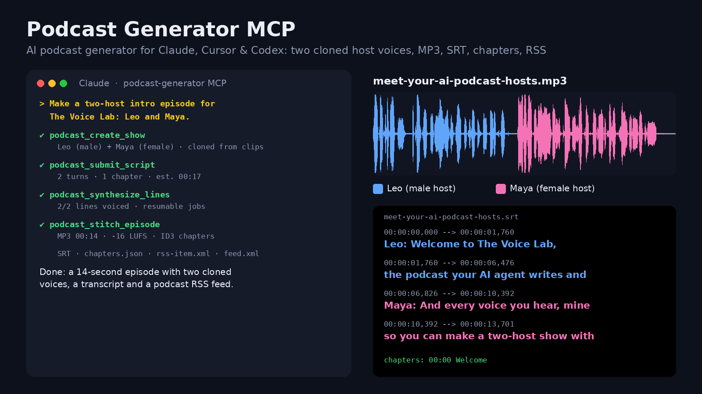
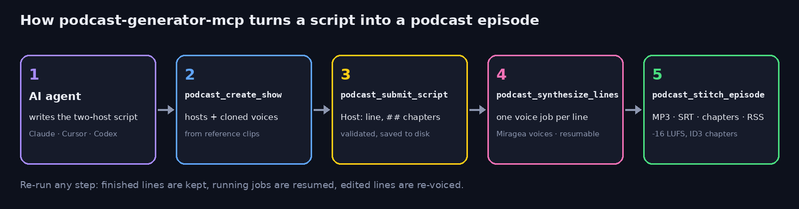

# Podcast Generator MCP: AI podcast generator for Claude, Cursor and Codex

[](https://github.com/RTY2345RR/podcast-generator-mcp/actions/workflows/ci.yml)
[](https://registry.modelcontextprotocol.io/v0/servers?search=podcast-generator-mcp)
[](https://hub.docker.com/r/miragea/podcast-generator-mcp)
[](pyproject.toml)
[](LICENSE)
[](https://huggingface.co/spaces/miragea/podcast-generator-mcp)

**Podcast Generator MCP is an open-source podcast MCP server that turns any AI agent (Claude, Cursor, Codex, VS Code, Windsurf) into an AI podcast generator: the agent writes a two-host dialogue script, and the server voices every line with each host's own cloned voice, stitches one loudness-normalized MP3, and exports a transcript SRT, chapters and a podcast RSS item and feed.** You say *"make a 10-minute episode about this PDF with Leo and Maya"*; the agent reads the source and writes the script, the server does everything that touches audio. It is text to podcast, inside the tools you already use.



▶ **Listen to the real output:** [two-host episode (MP3, 14 s)](examples/two-host-podcast-demo/meet-your-ai-podcast-hosts.mp3) · [transcript SRT](examples/two-host-podcast-demo/meet-your-ai-podcast-hosts.srt) · [chapters JSON](examples/two-host-podcast-demo/meet-your-ai-podcast-hosts.chapters.json) · [RSS feed](examples/two-host-podcast-demo/feed.xml) · [input script](examples/two-host-podcast-demo/script.md) · or play it in the browser on the [Hugging Face demo page](https://huggingface.co/spaces/miragea/podcast-generator-mcp). Leo (male) and Maya (female) are both cloned from short public clips.

<!-- mcp-name: io.github.RTY2345RR/podcast-generator-mcp -->

## Contents
- [Why this podcast MCP server](#why-this-podcast-mcp-server)
- [How the AI podcast generator works](#how-the-ai-podcast-generator-works)
- [Quick start](#quick-start)
- [Example: text to podcast with two cloned hosts](#example-text-to-podcast-with-two-cloned-hosts)
- [Script format](#script-format)
- [Tools](#tools)
- [Publish the podcast: RSS feed, chapters, transcript](#publish-the-podcast-rss-feed-chapters-transcript)
- [Comparison with other podcast generators](#comparison-with-other-podcast-generators)
- [FAQ](#faq)
- [Troubleshooting](#troubleshooting)
- [Related projects](#related-projects)

## Why this podcast MCP server
- **Your hosts, your voices.** Each host is cloned from a 5-20 second public clip (or uses a saved voice), so a show can sound like you and your co-host, not like a stock voice list.
- **The agent writes, the server produces.** No second LLM key and no hidden prompt: Claude, Cursor or Codex writes the dialogue in your chat, where you can read and edit it before a single line is voiced.
- **A real episode, not a pile of clips.** One MP3 (mono 128 kbps, -16 LUFS, ID3 tags and chapters), an SRT transcript with speaker names, a plain-text transcript, Podcasting 2.0 chapters JSON, `00:00 Title` chapter text for show notes, an RSS `<item>` and a complete `feed.xml`.
- **Resumable and cheap to fix.** Every line is one voice job saved on disk. A timeout never loses work: run the same tool again and it polls the saved jobs, with no duplicate jobs on retry. Edit one line in the script and only that line is re-voiced.
- **Any number of hosts (up to 6).** Two-host podcasts, interviews with a guest, panel shows, or a solo narrator with chapters.
- **One-command install.** `uvx` runs it; ffmpeg comes bundled. Works on macOS, Linux and Windows with MCP SDK 1.x and 2.x.

## How the AI podcast generator works



1. **`podcast_create_show`**: title, metadata and hosts. Each host gets a voice from `reference_audio_url` + `reference_text` (cloned) or `actor_id` (saved voice).
2. **The agent writes the script** from a topic, a PDF, a web page, a YouTube transcript or your notes: one turn per line as `Leo: ...`, with `## Chapter` lines.
3. **`podcast_submit_script`** validates hosts and turns, and returns turns per host, word count and an estimated duration.
4. **`podcast_synthesize_lines`** voices each line with its host's voice, several in parallel. Voices are rendered by the [Miragea](https://miragea.ai) voice and voice-cloning engine.
5. **`podcast_stitch_episode`** trims each clip, adds natural gaps between turns and a longer breath before chapters, normalizes loudness and writes every export.

## Quick start
You need [uv](https://docs.astral.sh/uv/) and a voice engine key (`MIRAGEA_API_KEY`, created at [miragea.ai/workspace/api](https://miragea.ai/workspace/api)). Agents can also follow the setup guide: Install https://miragea.ai/skills/miragea-audio/install.md

**Claude Code**
```bash
claude mcp add podcast-generator -s user -e MIRAGEA_API_KEY=<your-key> -- uvx --from git+https://github.com/RTY2345RR/podcast-generator-mcp podcast-generator-mcp
```

**Claude Desktop / Cursor / Windsurf** (`claude_desktop_config.json`, `~/.cursor/mcp.json`)
```json
{
  "mcpServers": {
    "podcast-generator": {
      "command": "uvx",
      "args": ["--from", "git+https://github.com/RTY2345RR/podcast-generator-mcp", "podcast-generator-mcp"],
      "env": { "MIRAGEA_API_KEY": "<your-key>" }
    }
  }
}
```

**Codex** (`~/.codex/config.toml`)
```toml
[mcp_servers.podcast-generator]
command = "uvx"
args = ["--from", "git+https://github.com/RTY2345RR/podcast-generator-mcp", "podcast-generator-mcp"]
tool_timeout_sec = 1800
env = { MIRAGEA_API_KEY = "<your-key>" }
```

**VS Code**: `podcast-generator-mcp --print-config vscode` prints the `servers` block. Every client: `--print-config claude-desktop|cursor|claude-code|codex|vscode|windsurf`.

**Docker**: `docker run -i --rm -e MIRAGEA_API_KEY -v ~/Podcasts:/data miragea/podcast-generator-mcp`

Check the setup without creating any job:
```bash
MIRAGEA_API_KEY=<your-key> uvx --from git+https://github.com/RTY2345RR/podcast-generator-mcp podcast-generator-mcp --check
```

| Environment variable | Default | Purpose |
|---|---|---|
| `MIRAGEA_API_KEY` | (required) | Voice engine key. Kept out of logs and errors. |
| `PODCAST_OUTPUT_DIR` | `~/Podcasts` | Where shows, episodes and exports are saved. |
| `PODCAST_CONCURRENCY` | `4` | Lines voiced in parallel. |
| `MIRAGEA_WAIT_TIMEOUT` | `900` | Seconds a tool waits for running lines before returning progress. |
| `FFMPEG_BINARY` | auto | Use a specific ffmpeg instead of PATH or the bundled one. |

## Example: text to podcast with two cloned hosts
Prompt in Claude, Cursor or Codex:

> Create a show "The Voice Lab" with Leo (male, clone http://festvox.org/cmu_arctic/cmu_arctic/cmu_us_bdl_arctic/wav/arctic_a0003.wav) and Maya (female, clone http://festvox.org/cmu_arctic/cmu_arctic/cmu_us_slt_arctic/wav/arctic_a0003.wav; both clips say "For the twentieth time that evening the two men shook hands."). Write a one-line-each welcome and produce the episode.

What the agent calls:
```text
podcast_create_show(title="The Voice Lab", hosts=[{name:"Leo", reference_audio_url:..., reference_text:...}, {name:"Maya", ...}])
podcast_submit_script(show_id="the-voice-lab", title="Meet your AI podcast hosts", script="""
## Welcome
Leo: Welcome to The Voice Lab, the podcast your AI agent writes and produces from a single script.
Maya: And every voice you hear, mine included, is cloned from a short clip, so you can make a two-host show with your own voices in minutes.
""")
podcast_generate_episode(show_id="the-voice-lab", episode_id="meet-your-ai-podcast-hosts")
```

Real result ([examples/two-host-podcast-demo](examples/two-host-podcast-demo)): a 14.3-second MP3 with an ID3 chapter, and this SRT:
```srt
1
00:00:00,000 --> 00:00:01,760
Leo: Welcome to The Voice Lab,

2
00:00:01,760 --> 00:00:06,476
the podcast your AI agent writes and produces from a single script.

3
00:00:06,826 --> 00:00:10,392
Maya: And every voice you hear, mine included, is cloned from a short clip,

4
00:00:10,392 --> 00:00:13,701
so you can make a two-host show with your own voices in minutes.
```
Re-transcribing the MP3 gives back the script word for word, and the two voices sit where you expect (median pitch about 120 Hz for Leo, 180 Hz for Maya).

Files written to `~/Podcasts/shows/the-voice-lab/`:
```text
feed.xml
episodes/meet-your-ai-podcast-hosts/
  meet-your-ai-podcast-hosts.mp3            episode, -16 LUFS, ID3 tags + chapters
  meet-your-ai-podcast-hosts.srt            transcript captions with speaker names
  meet-your-ai-podcast-hosts.txt            plain transcript
  meet-your-ai-podcast-hosts.chapters.json  Podcasting 2.0 chapters
  meet-your-ai-podcast-hosts.chapters.txt   00:00 Welcome
  meet-your-ai-podcast-hosts.rss-item.xml   <item> for an existing feed
  lines/*.wav                               one clip per line (kept for resume)
```

## Script format
Text, one turn per line (the agent writes this):
```text
## Intro
Leo: So Maya, what are we covering today?
Maya: (laughs) Everything about home espresso, in ten minutes.
Leo: Bold. Let's go.
[chapter: Beans]
**Maya:** First, freshness beats everything, every single time.
It is the one rule I never break.
```
- `Host: text`, `[Host]: text`, `**Host:** text` and `- Host: text` all work; host names match case-insensitively.
- `## Title` or `[chapter: Title]` starts a chapter (written to the MP3, the chapters JSON and the RSS description).
- A line without a host tag continues the previous turn. An unknown host name is an error, so typos never voice the wrong person.
- A leading `(tag)` is passed to the voice engine as a voice tag; `podcast_check_setup` lists the tags each model accepts.

Or a list, for full control:
```json
[{"host": "Leo", "text": "Welcome back.", "chapter": "Intro"},
 {"host": "Maya", "text": "Good to be here.", "pause_after": 0.8}]
```

## Tools
| Tool | What it does |
|---|---|
| `podcast_check_setup` | Key set (hidden), voice engine reachable, models, voice tags, limits, ffmpeg, output folder. Read-only. |
| `podcast_list_voices` | Saved voices on the account, for hosts with `actor_id`. |
| `podcast_create_show` | Show + hosts (cloned voice or saved voice) + RSS metadata. |
| `podcast_set_host` | Add a host or change a host's voice; their lines are re-voiced on the next run. |
| `podcast_submit_script` | Save or update an episode script; returns turns per host, chapters, words, estimated duration. |
| `podcast_synthesize_lines` | Voice every unvoiced line in parallel; resumable; `lines=[3,7]` re-voices just those. |
| `podcast_stitch_episode` | MP3 + SRT + TXT + chapters JSON/TXT + RSS item + feed.xml. No voice-engine call. |
| `podcast_generate_episode` | Synthesize + stitch in one call; returns progress if lines are still rendering. |
| `podcast_episode_status` | Lines voiced, failed lines with reasons, output files, next step. |
| `podcast_get_script` | The saved script as numbered turns, with voiced or not. |
| `podcast_list_shows` | Shows, hosts and episode ids. |

## Publish the podcast: RSS feed, chapters, transcript
`feed.xml` is a valid RSS 2.0 podcast feed with the iTunes and Podcasting 2.0 namespaces (`podcast:transcript`, `podcast:chapters`, `podcast:person`, `podcast:guid`). To publish:

1. Upload each episode's `.mp3`, `.srt` and `.chapters.json` and the show's `feed.xml` to one public folder (S3, Cloudflare R2, GitHub Pages, your site).
2. Run `podcast_stitch_episode(..., base_url="https://your.cdn/podcast")` (or set `base_url` on the show) so enclosure, transcript and chapter links are absolute. No re-voicing happens.
3. Submit the feed URL to Apple Podcasts, Spotify for Creators, Pocket Casts or Podcast Index. Set `artwork_url`, `owner_email`, `category` and `author` on the show for directory requirements.

Already have a host (Buzzsprout, Transistor, RSS.com)? Upload the MP3 and paste `chapters.txt` into the show notes and the SRT as the transcript.

## Comparison with other podcast generators
| | **Podcast Generator MCP** | [ElevenLabs MCP](https://github.com/elevenlabs/elevenlabs-mcp) | [adamanz/podcast-generator-mcp](https://github.com/adamanz/podcast-generator-mcp) | [Podcastfy](https://github.com/souzatharsis/podcastfy) | NotebookLM Audio Overviews |
|---|---|---|---|---|---|
| Works inside Claude / Cursor / Codex (MCP) | ✅ | ✅ | ✅ | ❌ (Python library / CLI) | ❌ (web app) |
| Built to make a whole multi-host episode | ✅ | ❌ (single text-to-speech calls) | ✅ | ✅ | ✅ |
| Each host cloned from your own clip | ✅ (clip URL, per host) | ✅ (`voice_clone` from local files) | ❌ (stock voices) | ⚠️ (provider voice ids; cloning happens elsewhere) | ❌ |
| Script written and editable by your agent | ✅ | n/a | ❌ (server calls its own LLM) | ❌ (internal LLM) | ❌ |
| Re-voice only edited lines / resume after timeout | ✅ | ❌ | ❌ | ❌ | ❌ |
| Transcript SRT with speaker names | ✅ | ❌ (speech-to-text tool only) | ❌ | ❌ (text transcript) | ❌ |
| Chapters (ID3 + Podcasting 2.0 JSON) | ✅ | ❌ | ❌ | ❌ | ❌ |
| RSS item + feed.xml | ✅ | ❌ | ❌ | ❌ | ❌ |
| Loudness normalization | ✅ (-16 LUFS) | ❌ | ✅ (ffmpeg normalize) | not documented | n/a |
| Actively maintained (Nov 2026) | ✅ | ✅ | ❌ (last push June 2025) | ❌ (last push May 2026) | n/a |

ElevenLabs MCP is a general voice toolbox (text to speech, cloning, transcription, sound effects, agents). Use it for one-off voice clips; use this server when the output is a podcast episode.

## FAQ
**What is a podcast MCP server?**
An MCP (Model Context Protocol) server that gives an AI assistant tools to create podcasts. With this one, Claude, Cursor or Codex can create a show, write a host-tagged script, voice it with cloned voices and export an episode with MP3, transcript, chapters and RSS.

**How do I make an AI podcast with two hosts?**
Create a show with two hosts (each with a reference clip or saved voice), ask your agent to write a dialogue as `Host: line` turns, then call `podcast_generate_episode`. The example above is a full run.

**Can I use my own voice for the podcast?**
Yes. Record 5-20 seconds of clean speech, put it at any public URL (your site, S3, GitHub raw), and pass it as the host's `reference_audio_url` with the exact words as `reference_text`. Only clone voices you have the right to use.

**Is this a NotebookLM podcast alternative?**
For the audio part, yes: it produces a two-host conversation from any source your agent can read (PDF, web page, notes, YouTube transcript). The difference is that you choose the hosts' voices, read and edit the script, and get MP3, SRT, chapters and RSS files you own.

**How do I turn a PDF into a podcast (pdf to podcast)?**
Attach or point the agent at the PDF and ask for an episode: *"Turn report.pdf into a 6-minute two-host episode for The Voice Lab, with chapters per section."* The agent reads the PDF and writes the script; the server voices it.

**Does the server need an OpenAI or Anthropic key?**
No. The agent you are already talking to writes the script. The only key is the voice engine key (`MIRAGEA_API_KEY`).

**How long can an episode be?**
Up to 2,000 turns of up to 4,000 characters each. Lines are voiced in parallel (`PODCAST_CONCURRENCY`), and long runs return progress instead of blocking; call the tool again to continue.

**Which languages are supported?**
Write the script in the language you want the episode in; English is tested end to end. For another language, voice one line first (`podcast_synthesize_lines(..., lines=[1])`) and listen. Set `language` on the show for the RSS feed.

**Can I edit one line without re-making the whole episode?**
Yes. Submit the edited script with the same `episode_id`; unchanged turns keep their audio and only the changed ones are voiced. Then stitch again.

**Is there a text to podcast API?**
This server is one: any MCP client can call it over stdio. For direct HTTP use, see the voice engine guide at https://miragea.ai/skills/miragea-audio/install.md.

## Troubleshooting
| Problem | Fix |
|---|---|
| `MIRAGEA_API_KEY is not set` | Add it to the server's `env` block in your MCP client config and restart the client. |
| A cloned line fails with `synthesis_failed` | The engine could not download the clip. Use a direct public WAV/MP3 URL (not a web page, not Hugging Face), 5-20 s, one speaker. |
| The tool returns `still rendering` | Normal for long episodes: call `podcast_synthesize_lines` or `podcast_generate_episode` again. Jobs resume, nothing is submitted twice. |
| The client times out before the tool returns | Raise the client's tool timeout (Codex: `tool_timeout_sec = 1800`) or lower `MIRAGEA_WAIT_TIMEOUT` so tools return progress sooner. |
| `unknown host 'Sam'` | The script uses a name that is not a host. Fix the name or add the host with `podcast_set_host`. |
| `ffmpeg was not found` | Install ffmpeg or set `FFMPEG_BINARY`; normally the bundled imageio-ffmpeg binary is used. |
| HTTP 403 from the API | Network filtering of the request; make sure nothing strips the User-Agent header (proxies), then retry. |

## Related projects
- [youtube-dubbing-mcp](https://github.com/RTY2345RR/youtube-dubbing-mcp): AI dubbing MCP server with one cloned voice per speaker and YouTube multi-language audio tracks.
- [miragea-voice-mcp](https://github.com/RTY2345RR/miragea-voice-mcp) (PyPI `tts-mcp-server`): text to speech, voiceover and SRT/VTT captions for AI agents.
- [miragea-agent-skills](https://github.com/RTY2345RR/miragea-agent-skills): Agent Skills for voiceover and dubbing in Claude Code and other agents.

## Development
```bash
git clone https://github.com/RTY2345RR/podcast-generator-mcp && cd podcast-generator-mcp
uv venv && uv pip install -e ".[dev]"
python -m pytest        # mocked voice engine, real ffmpeg, no key needed
```

## Credits
Voices are rendered and cloned by the [Miragea](https://miragea.ai) voice engine. Demo reference clips come from the CMU ARCTIC speech database; see [CREDITS.md](CREDITS.md). MIT licensed, see [LICENSE](LICENSE).
